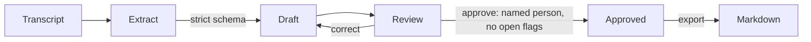

# SYNTHETIC voice note to document proof

[](https://github.com/asadullah48/voice-note-to-doc-demo/actions/workflows/ci.yml)

## What it is

An offline demo that turns prepared voice-note **transcripts** (text, not audio) into
Markdown meeting notes and order summaries. **All data is SYNTHETIC**: every transcript
starts with a `SYNTHETIC` line, every draft and export carries a `**SYNTHETIC**` label, and
the demo prints `SYNTHETIC DATA ONLY` first. Do not use it with real people or real data
(see [SECURITY.md](SECURITY.md)).

It extracts people, topics, quantities, dates and action items, flags missing or unclear
values, and only exports a draft that a named person approved. Draft state and an
append-only audit log live in one SQLite file; every state change commits together with
its audit row.



## Quick start

Python 3.11 or newer, from this folder:

```powershell
python -m pip install -e .
python -m voice_to_doc demo
```

The demo extracts one bundled SYNTHETIC order transcript into `./voice_to_doc.db`
(`--db PATH` or `VOICE_TO_DOC_DB` to change it), prints the draft, its flags and its state
(`flagged`: the delivery date is "next Friday"), tries to export and shows the refusal,
then prints the exact commands a person runs:

```text
python -m voice_to_doc --db "voice_to_doc.db" correct 1 date 2026-11-20 --actor "<your name>"
python -m voice_to_doc --db "voice_to_doc.db" approve 1 --actor "<your name>"
python -m voice_to_doc --db "voice_to_doc.db" export 1 --out "out" --actor "<your name>"
```

(The draft id is printed by the demo; it is `1` in a new database.) **The demo never
approves anything.** Other commands: `extract FILE [--extractor rules|llm]`, `show ID`,
`next ID --actor NAME`, `audit [ID]`.

## State table

States are derived from stored data, never set by hand. A draft is `approved` only while
the stored approval hash equals the current content hash **and** no flags are open, so any
edit removes approval. `pending or flagged` means re-validated: an edit that adds a flag
gives `flagged`, never `approved`. A `code` cell is the typed error raised (and audited).
Generated from `TRANSITIONS` in `src/voice_to_doc/review.py`; a test checks they match.

| state \ action | correct | approve | next | export |
|---|---|---|---|---|
| pending | pending or flagged | approved | pending | `ExportBlocked` |
| flagged | pending or flagged | `ApprovalBlocked` | flagged | `ExportBlocked` |
| approved | pending or flagged | `AlreadyApproved` | approved | approved |

An approval with an empty or whitespace actor raises `ActorRequired` and is audited as
`rejected`.

## How it is built

| Module (`src/voice_to_doc/`) | Role |
| --- | --- |
| `extract.py` | Explicit labels first, then a rule-based fallback for unlabeled lines. |
| `extractors.py` | `TranscriptExtractor` protocol. Default `RuleExtractor`; optional `LLMExtractor`. `check_fields` checks any extractor's output strictly: known fields only, each a list of non-empty single-line strings. Review-control keys (`approval`, `approved`, `approved_by`, `state`, `status`, `reviewer`) raise `ExtractorSchemaError`, and no draft is created. Extractors return plain data only. |
| `draft.py` | `validate` returns typed `Flag`s; `render` builds the Markdown; `content_hash` is SHA-256 of the canonical (sorted, compact JSON) fields. |
| `models.py` | Frozen dataclasses `Transcript`, `Flag`, `Approval` (actor, `ts_utc`, `content_hash`) and `DraftState`. |
| `review.py` | The transition table and `Workflow`. `approve()` is the only place an `Approval` is created, and only the CLI `approve` command calls it (a test checks this). |
| `store.py` | One SQLite file (stdlib `sqlite3`): `PRAGMA user_version` schema version, foreign keys on, `BEGIN IMMEDIATE` writes. `Store.change` is the only way state changes: the state write and its `ok` audit row share one transaction. Blocked, rejected and failed actions change no state and write their audit row in their own transaction. Missing, corrupt or newer-version files give a clear error and no writes. |
| `audit.py` | Append-only `audit` table; triggers raise on UPDATE and DELETE. Columns: `id`, `ts_utc`, `actor`, `action`, `outcome` (ok / blocked / rejected / failed), `draft_id`, `reason_code` (for example `changed:quantity`, `open_flags`), `before_hash`, `after_hash`. It stores changed field names and hashes, never transcript text or corrected values. |
| `export.py` | Approved drafts only: temp file, fsync, `os.replace` to `<name>-<first 12 hash chars>.md`, then one transaction for the exported state plus its audit row. |
| `cli.py` | `python -m voice_to_doc` / `voice-to-doc`. |

**Optional LLM extractor.** Off by default. It needs `pip install -e ".[llm]"`, the
`VOICE_TO_DOC_ANTHROPIC_API_KEY` environment variable **and** `--extractor llm`. Its output
goes through the same strict schema and review flags; it can never approve anything.
**This code path has never been executed.**

## Extraction eval

`samples/*.expected.json` (four demo transcripts) and `samples/eval/` (four extra probes
written to hit known gaps) hold hand-written expected people, quantities, dates and
actions. Annotation rules and scoring: [samples/eval/README.md](samples/eval/README.md).
8 hand-written synthetic transcripts; this is not an accuracy estimate. The test fails if
any field's hits drop or false positives rise against `samples/eval/baseline.json`
(unchanged in this upgrade).

## Tests

```powershell
python -m pip install -e ".[dev]"
ruff check .
ruff format --check .
mypy
python -m pytest
```

No test calls the network or the LLM extractor; tests that touch extractors or the CLI
block `socket.socket`.

## Verified

CI: run #2 on main, commit a3f74ef, passed on Python 3.11 and 3.12 (verified 21 Nov 2026).

Local runs (not CI), on Windows 11, 21 Nov 2026, each in a fresh venv with
`pip install -e ".[dev]"` (ruff 0.17.6, mypy 2.4.1, pytest 9.2.0):

| Python | `ruff check .` | `ruff format --check .` | `mypy` (strict, `src/`) | `python -m pytest` | `python -m voice_to_doc demo` |
| --- | --- | --- | --- | --- | --- |
| 3.11.15 | All checks passed | 25 files already formatted | no issues in 11 files | 109 passed, 22 subtests passed | exit 0, banner, export refused |
| 3.12.13 | All checks passed | 25 files already formatted | no issues in 11 files | 109 passed, 22 subtests passed | exit 0, banner, export refused |
| 3.13.15 | All checks passed | 25 files already formatted | no issues in 11 files | 109 passed, 22 subtests passed | exit 0, banner, export refused |
| 3.14.7 | All checks passed | 25 files already formatted | no issues in 11 files | 109 passed, 22 subtests passed | exit 0, banner, export refused |
| 3.14.7 free-threaded | All checks passed | 25 files already formatted | no issues in 11 files | 109 passed, 22 subtests passed | exit 0, banner, export refused |

Eval table, copied from the `python -m pytest` output (identical on all five runs):

```text
Extraction eval (8 SYNTHETIC transcripts, micro-averaged)
field        tp  fp  fn  precision  recall
people        6   0   3       1.00    0.67
quantities    7   0   1       1.00    0.88
dates         9   0   1       1.00    0.90
actions      10   1   1       0.91    0.91
```

8 hand-written synthetic transcripts; this is not an accuracy estimate.

Also run locally on 21 Nov 2026 (Python 3.12.13):
- A test runs the demo's printed `correct`, `approve` and `export` commands against the
  same database file and gets one exported file.
- Mutation check: with the transaction wrapper removed from `Store.change`, the two
  atomicity tests (failure after the state write, failure on the audit insert) failed;
  restored, they pass.
- Mutation check: letting extractor output carry an approval made 19 control tests fail;
  restored, they pass.

## Limits

- Input is prepared text. No audio, no speech-to-text, no live integrations.
- Known misses of the rules extractor, copied from the eval run on 21 Nov 2026
  (7 differences in total):
  - People missed: SYNTHETIC_PERSON_ALPHA and SYNTHETIC_PERSON_BETA in `spelled-out`,
    and SYNTHETIC_PERSON_ALPHA in `urdu-word-order`. Names are only found right after
    "to", "for" or "ko".
  - Quantity missed: "twenty boxes" in `spelled-out`. Spelled-out numbers are not read.
  - Date missed: "tomorrow" in `spelled-out`.
  - Action missed: "Ship 15 units to SYNTHETIC_PERSON_BETA on 3 Dec" in `ship-verb`.
    "Ship" is not an action word.
  - False action: "Do not send anything to SYNTHETIC_PERSON_BETA" in `negation` is
    copied as an action. It is then flagged for its negative wording.
- The fallback reads quantities with digits followed by pieces, units, boxes, dozen or
  than; ISO dates, day-and-month phrases, weekday names, "kal", "parson", "next week". A
  reviewer must replace any non-ISO date with an exact YYYY-MM-DD date. No calendar
  inference. It copies full lines with the words "send", "call", "deliver", "bhejna" or
  "check" and flags cues such as "maybe", "if", "not" and question marks. It only
  recognizes allowlisted synthetic people and leaves document type and topic to the reviewer.
- The export file and the database are not atomic together. A crash after the file is
  replaced and before the DB transaction commits leaves an orphan Markdown file and no
  audit row claiming the export.
- Single-user SQLite. No claim about concurrent use.
- The approval actor is a name typed on the CLI. It is not authenticated.
- The audit table is append-only through SQL triggers. This stops normal UPDATE and
  DELETE. Anyone who can edit the DB file can drop the triggers. So it is
  tamper-resistant, not tamper-evident. A hash chain is under "Not built yet".
- The audit stores field names and hashes only, not transcript text or corrected values.
- The LLM extractor has never been executed; `pip install -e ".[llm]"` was not run.
- Linux and macOS were not tested locally. CI (`.github/workflows/ci.yml`) runs on
  `ubuntu-latest` only, with Python 3.11 and 3.12. macOS and Windows are not in CI.
- The eval set is eight synthetic transcripts annotated by the author; no second
  annotator, no real-data eval.

## Not built yet

- Tamper-evident audit (for example a hash chain).
- Multi-user approval or a shared review queue; reviewer authentication.
- Real transcripts or real data; audio input and transcription.
- A live-tested LLM extractor, or an eval of one.

## What a paid version would add

**PROPOSED** — Audio transcription, broader mixed-language extraction, source timestamps
for reviewer checks, a shared review queue with approval history, and approved export to
the team's document system.

Historical notes: [docs/history/](docs/history/README.md).
