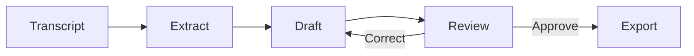

# SYNTHETIC voice note to document proof

## What it does

This offline demo turns prepared voice-note transcripts into Markdown meeting
notes and order summaries. It extracts people and topics where supported,
quantities, dates, and action items. It flags missing or unclear details before
approval. Editing an approved draft clears its approval until the reviewer
approves the revised draft.



## How to run

From this folder with Python 3.11 or newer:

```powershell
python voice_to_doc.py
```

The script prints all four drafts and their review flags. The simulated reviewer
tries to approve the order with a relative date, supplies an exact date,
approves, changes the quantity, and re-approves. The other drafts stay pending.
The script prints the path of the approved order summary under
`exports/run-*/`. Each export uses a fresh folder.

For hands-on review:

```powershell
python voice_to_doc.py --review
```

Type `approve`, a correction such as `date: 2026-11-20`, or `next` to move
to the next draft. To correct a draft after approving it, enter the correction
before typing `next`, then approve again. The script exports approved drafts at
the end of the session. The `action` correction replaces the draft's action list
with the action you enter.

## What is SYNTHETIC

The text files in `samples/` are invented business notes with fictional team
and person labels, with invented quantities and dates. The prepared transcripts
include labeled and unlabeled English and mixed Urdu-English examples. Each transcript and Markdown draft carries a SYNTHETIC
label.

## Tests

```powershell
python -B -m unittest discover -v
```

## Limits

- The parser accepts explicit labels, including the aliases listed in
  the script. For each field, a recognized label takes priority over free speech.
- The fallback reads quantities with digits followed by pieces, units, boxes,
  dozen or than. It flags supported approximation words, decimal values, and
  ranges it recognizes. It cannot read spelled-out numbers or convert units.
- The fallback captures ISO dates, day-and-month phrases with an optional year,
  English weekday names with optional “next”, and “kal”, “parson”, and
  “next week”. A reviewer must replace any non-ISO or invalid date with a
  valid YYYY-MM-DD date. No calendar inference or relative date conversion.
- The fallback copies full lines with the exact words “send”, “call”, “deliver”,
  “bhejna”, or “check”. It flags supported cues such as “maybe”, “if”,
  “not”, and question marks. It cannot reliably determine intent, understand
  every hedge or negation, or recognize all verb forms and spellings.
- The fallback only recognizes allowlisted synthetic people immediately after
  “to”, “for”, or “ko”. That mention may be a recipient or beneficiary.
  It cannot identify the speaker, other names, or a person's role. It leaves
  the document type and topic for the reviewer to enter.
- Missing required values and conflicting single-field candidates block approval.
  Orders require a quantity. Both document types require actions.
- Python standard library only. No audio, real transcription, API keys, or
  live integrations.
- Review state lives in memory for one run. The export is a local Markdown
  snapshot of an approved revision.

## What a paid version would add

**PROPOSED** — Audio transcription, broader mixed-language extraction, source
timestamps for reviewer checks, a shared review queue with approval history,
and approved export to the team's document system.
