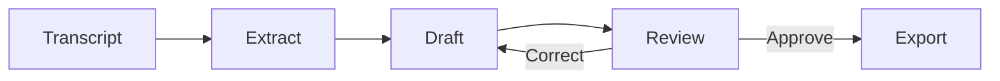

# SYNTHETIC voice note to document proof

## What it does

This offline demo turns prepared voice-note transcripts into Markdown meeting
notes and order summaries. It extracts who spoke, what the note covers,
quantities, dates, and action items. It flags missing or unclear details before
approval. Editing an approved draft clears its approval until the reviewer
approves the revised draft.



## How to run

From this folder with Python 3.11 or newer:

```powershell
python voice_to_doc.py
```

The script prints both drafts and their review flags. The simulated reviewer
tries to approve the order with a relative date, supplies an exact date,
approves, changes the quantity, and re-approves. The meeting note stays pending.
The script prints the path of the approved order summary under
`exports/run-*/`. Each export uses a fresh folder.

For hands-on review:

```powershell
python voice_to_doc.py --review
```

Type `approve`, a correction such as `date: 2026-11-20`, or `next` to move
to the next draft. To correct a draft after approving it, enter the correction
before typing `next`, then approve again. The script exports approved drafts at
the end of the session. The `action` correction replaces the draft's action list
with the action you enter.

## What is SYNTHETIC

The text files in `samples/` are invented business notes with fictional team
labels. They represent prepared transcripts and include English and mixed
Urdu-English labels. Each transcript and Markdown draft carries a SYNTHETIC
label.

## Tests

```powershell
python -B -m unittest discover -v
```

## Limits

- Python standard library only. Runs without audio, real transcription, API keys,
  or live integrations.
- Extraction uses explicit labels, including `Qty`, `Tareekh`, and
  `Agla kaam`. Free-form speech and implied details are outside the parser's scope.
- Orders require a quantity. Meeting notes can omit it. Dates must be explicit
  and actions are required for both document types.
- Review state lives in memory for one run. The export is a local Markdown
  snapshot of an approved revision.

## What a paid version would add

**PROPOSED** — Audio transcription, broader mixed-language extraction, source
timestamps for reviewer checks, a shared review queue with approval history,
and approved export to the team's document system.
