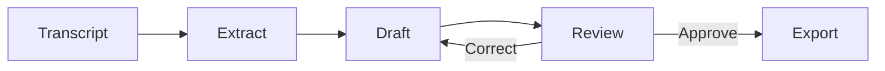

# SYNTHETIC voice note to document proof

[](https://github.com/asadullah48/voice-note-to-doc-demo/actions/workflows/test.yml)

## What it does

This offline demo turns prepared voice-note **transcripts** (text, not audio) into
Markdown meeting notes and order summaries. It extracts people and topics where
supported, quantities, dates, and action items. It flags missing or unclear details
before approval. Editing an approved draft clears its approval until a reviewer
approves the revised draft. Draft state and an append-only audit log live in one SQLite
file, and each state change commits together with its audit row.



## How to run

From this folder with Python 3.11 or newer:

```powershell
python -m pip install -e .
python -m voice_to_doc demo
```

The demo extracts one bundled SYNTHETIC order transcript into `./voice_to_doc.db`
(`--db PATH` or `VOICE_TO_DOC_DB` to change it), prints the draft, its flags and its
state (`flagged`), tries to export and shows that export is refused, then prints the
exact `correct`, `approve` and `export` commands a person runs. **The demo never
approves anything.** Other commands: `extract FILE`, `show ID`, `next ID --actor NAME`,
`audit [ID]`.

## State table

States are derived from stored data, never set by hand. A draft is `approved` only while
the stored approval hash equals the current content hash **and** no flags are open, so any
edit removes approval. `pending or flagged` means re-validated: an edit that adds a flag
gives `flagged`, never `approved`. A `code` cell is the typed error raised (and audited).
Generated from `TRANSITIONS` in `src/voice_to_doc/review.py`; a test checks they match.

| state \ action | correct | approve | next | export |
|---|---|---|---|---|
| pending | pending or flagged | approved | pending | `ExportBlocked` |
| flagged | pending or flagged | `ApprovalBlocked` | flagged | `ExportBlocked` |
| approved | pending or flagged | `AlreadyApproved` | approved | approved |

## How it is built

| Module (`src/voice_to_doc/`) | Role |
| --- | --- |
| `extract.py` | Explicit labels first, then a rule-based fallback for unlabeled lines. |
| `extractors.py` | `TranscriptExtractor` protocol. Default `RuleExtractor`; optional `LLMExtractor` (see below). `check_fields` validates any extractor's output strictly: known fields only, each a list of non-empty single-line strings; review-control keys (`approval`, `approved`, `approved_by`, `state`, `status`, `reviewer`) raise `ExtractorSchemaError` and no draft is created. |
| `draft.py` | `validate` returns typed `Flag`s; `render` builds the Markdown. |
| `models.py` | Frozen dataclasses `Transcript`, `Draft`, `Flag`, `Approval`, and `DraftState` = `pending` / `flagged` / `approved`. |
| `review.py` | The transition table and `Workflow`. `approve()` is the only place an `Approval` (actor, UTC time, content hash) is created, and only the CLI `approve` command calls it. |
| `store.py` | One SQLite file (stdlib `sqlite3`) for drafts and audit. `PRAGMA user_version` schema version, foreign keys on, `BEGIN IMMEDIATE` writes. `Store.change` is the only way state changes: the state write and its `ok` audit row share one transaction. Blocked/rejected/failed actions write only an audit row, in their own transaction. |
| `audit.py` | Append-only `audit` table (triggers raise on UPDATE and DELETE): `ts_utc`, `actor`, `action`, `outcome` (ok/blocked/rejected/failed), `draft_id`, `reason_code` (e.g. `changed:quantity`), and SHA-256 `before_hash`/`after_hash` of the canonical draft content. No transcript text or corrected values. |
| `export.py` | Approved drafts only: temp file, fsync, `os.replace` to `<name>-<hash12>.md`, then one transaction for exported state plus its audit row. |
| `cli.py` | `python -m voice_to_doc` / `voice-to-doc`. |

**Optional LLM extractor.** Off by default. It needs `pip install -e ".[llm]"`, the
`VOICE_TO_DOC_ANTHROPIC_API_KEY` env var **and** `--extractor llm`. Its output goes
through the same `check_fields` schema and the same review flags, and it can never
approve anything; a person still has to. **This code path has never been executed**
(see Verified).

## What is SYNTHETIC

The text files in `samples/` are invented business notes with fictional team
and person labels, with invented quantities and dates. The prepared transcripts
include labeled and unlabeled English and mixed Urdu-English examples. Each transcript
and Markdown draft carries a SYNTHETIC label.

## Extraction eval

`samples/*.expected.json` (four demo transcripts) and `samples/eval/` (four extra
probes written to hit known gaps) hold hand-written expected people, quantities,
dates and actions. Annotation rules and scoring are in
[samples/eval/README.md](samples/eval/README.md). `python -m pytest` prints:

```text
Extraction eval (8 SYNTHETIC transcripts, micro-averaged)
field        tp  fp  fn  precision  recall
people        6   0   3       1.00    0.67
quantities    7   0   1       1.00    0.88
dates         9   0   1       1.00    0.90
actions      10   1   1       0.91    0.91
```

These are counts on eight short synthetic transcripts that I wrote, four of them to
expose known misses (names not after "to/for/ko", spelled-out numbers, "tomorrow",
the verb "ship", a "do not send" line). They say nothing about accuracy on real voice
notes. The test fails if any field's hits drop or false positives rise versus
`samples/eval/baseline.json`.

## Tests

```powershell
python -m pip install -e ".[dev]"
ruff check .
ruff format --check .
mypy
python -m pytest
```

No test calls the network or the LLM extractor. Current counts are in Verified.

## Verified

Only what was actually run, on Windows, 20 Nov 2026:

- `python -m pytest`: **53 passed, 22 subtests passed** on Python 3.11.15 and 3.12.13
  (fresh venvs, `pip install -e ".[dev]"`) and on Python 3.14.
- `ruff check .`: clean with ruff 0.17.6 and 0.15.12.
- The eval table above, identical on 3.11 and 3.12.
- `voice-to-doc` console script from the 3.12 venv: drafts printed, order blocked,
  approved, edited back to `pending`, re-approved, exported; 5 audit lines written.
- Mutation check: making the extractor miss the verb "check" fails the eval test.
- `--extractor llm` without the key env var exits with `RuntimeError` before any import or call.

Not verified:
- GitHub Actions has not run. This checkout has no git remote; a public repository
  named `asadullah48/voice-note-to-doc-demo` exists, but these commits are not on it,
  so the badge does not describe this code yet.
- `LLMExtractor.extract` has never been executed, `pip install -e ".[llm]"` was not
  run, and no request has been sent to any model.
- Linux/macOS.

`HANDOVER.md` is a dated record of the earlier single-file version; its
`python -B -m unittest discover -v` command no longer works.

## Limits

- Input is prepared text. No audio, no speech-to-text, no live integrations.
- The parser accepts explicit labels, including the aliases listed in
  `src/voice_to_doc/extract.py`. For each field, a recognized label takes priority over free speech.
- The fallback reads quantities with digits followed by pieces, units, boxes,
  dozen or than. It flags supported approximation words, decimal values, and
  ranges it recognizes. It cannot read spelled-out numbers or convert units.
- The fallback captures ISO dates, day-and-month phrases with an optional year,
  English weekday names with optional “next”, and “kal”, “parson”, and
  “next week”. A reviewer must replace any non-ISO or invalid date with a
  valid YYYY-MM-DD date. No calendar inference or relative date conversion.
- The fallback copies full lines with the exact words “send”, “call”, “deliver”,
  “bhejna”, or “check”. It flags supported cues such as “maybe”, “if”,
  “not”, and question marks. It cannot reliably determine intent, understand
  every hedge or negation, or recognize all verb forms and spellings.
- The fallback only recognizes allowlisted synthetic people immediately after
  “to”, “for”, or “ko”. That mention may be a recipient or beneficiary.
  It cannot identify the speaker, other names, or a person's role. It leaves
  the document type and topic for the reviewer to enter.
- Missing required values and conflicting single-field candidates block approval.
  Orders require a quantity. Both document types require actions.
- No runtime dependencies on the default path (standard library only); the optional
  `[llm]` extra adds `anthropic`.
- State and audit share one single-user SQLite file; no claim is made about concurrent use.
- Export writes a file and then commits a DB row; these cannot be one transaction. A crash
  between the two leaves an orphan Markdown file and no audit row claiming the export.
- Reviewer names are plain strings, not authentication. The audit table refuses UPDATE and
  DELETE through SQLite triggers, but anyone with the file can rewrite it: it is not
  tamper-evident. It stores field names and content hashes, not corrected values.
- The eval set is eight synthetic transcripts annotated by the author; there is no
  second annotator and no real-data eval.

## Not built yet

- Audio input and transcription.
- A shared, multi-user review queue.
- Authentication for reviewers; tamper-evident audit storage.
- A live-tested LLM extractor, or an eval of one.
- Export to any document system.

## What a paid version would add

**PROPOSED** — Audio transcription, broader mixed-language extraction, source
timestamps for reviewer checks, a shared review queue with approval history,
and approved export to the team's document system.
