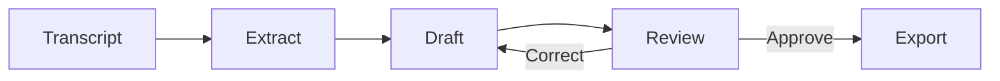

# SYNTHETIC voice note to document proof

[](https://github.com/asadullah48/voice-note-to-doc-demo/actions/workflows/test.yml)

## What it does

This offline demo turns prepared voice-note **transcripts** (text, not audio) into
Markdown meeting notes and order summaries. It extracts people and topics where
supported, quantities, dates, and action items. It flags missing or unclear details
before approval. Editing an approved draft clears its approval until a reviewer
approves the revised draft. Every review action is written to a JSONL audit log.



## How to run

From this folder with Python 3.11 or newer:

```powershell
python -m pip install -e .
python -m voice_to_doc demo
```

The demo extracts one bundled SYNTHETIC order transcript, prints the draft, its flags
and its state (`flagged`), tries to export and shows that export is refused, then
prints the command a person runs to review. **The demo never approves anything.**

For hands-on review of the four samples:

```powershell
python -m voice_to_doc review --samples samples --actor "<your name>"
```

Type `approve`, a correction such as `date: 2026-11-20`, or `next`. Approved drafts
are exported to `out/run-*/` at the end; review actions go to `out/audit.jsonl`.

## How it is built

| Module (`src/voice_to_doc/`) | Role |
| --- | --- |
| `extract.py` | Explicit labels first, then a rule-based fallback for unlabeled lines. |
| `extractors.py` | `TranscriptExtractor` protocol. Default `RuleExtractor`; optional `LLMExtractor` (see below). `check_fields` validates any extractor's output: known fields only, each a list of non-empty single-line strings. |
| `draft.py` | `validate` returns typed `Flag`s; `render` builds the Markdown. |
| `models.py` | Frozen dataclasses `Transcript`, `Draft`, `Flag`, `Approval`, and `DraftState` = `pending` / `flagged` / `approved`. |
| `review.py` | `Workflow`: state is derived (approved while an approval exists, else flagged if any flag, else pending). Any accepted edit clears the approval. Approval is blocked while flags remain. |
| `audit.py` | Append-only JSONL: one line per `approve` (ok/blocked), `correct` (ok/rejected) and interactive `next`, with time, document, reviewer, result, from/to state and the field/value or flags. The line is written before the in-memory change, so a failed write cancels the action. |
| `export.py` | Writes only the approved snapshot of each approved draft. |
| `cli.py` | `python -m voice_to_doc` / `voice-to-doc`. |

**Optional LLM extractor.** Off by default. It needs `pip install -e ".[llm]"`, the
`VOICE_TO_DOC_ANTHROPIC_API_KEY` env var **and** `--extractor llm`. Its output goes
through the same `check_fields` schema and the same review flags, and it can never
approve anything; a person still has to. **This code path has never been executed**
(see Verified).

## What is SYNTHETIC

The text files in `samples/` are invented business notes with fictional team
and person labels, with invented quantities and dates. The prepared transcripts
include labeled and unlabeled English and mixed Urdu-English examples. Each transcript
and Markdown draft carries a SYNTHETIC label.

## Extraction eval

`samples/*.expected.json` (four demo transcripts) and `samples/eval/` (four extra
probes written to hit known gaps) hold hand-written expected people, quantities,
dates and actions. Annotation rules and scoring are in
[samples/eval/README.md](samples/eval/README.md). `python -m pytest` prints:

```text
Extraction eval (8 SYNTHETIC transcripts, micro-averaged)
field        tp  fp  fn  precision  recall
people        6   0   3       1.00    0.67
quantities    7   0   1       1.00    0.88
dates         9   0   1       1.00    0.90
actions      10   1   1       0.91    0.91
```

These are counts on eight short synthetic transcripts that I wrote, four of them to
expose known misses (names not after "to/for/ko", spelled-out numbers, "tomorrow",
the verb "ship", a "do not send" line). They say nothing about accuracy on real voice
notes. The test fails if any field's hits drop or false positives rise versus
`samples/eval/baseline.json`.

## Tests

```powershell
python -m pip install -e ".[dev]"
ruff check .
python -m pytest
```

53 tests: 12 original workflow tests, 13 state tests (explicit states, typed approval,
editing an approved draft returns it to `pending` or `flagged`, flagged drafts cannot
be approved, immutable records), 6 audit tests (every action logged with correct
from/to states, append across workflows, a failed write leaves state unchanged,
interactive review, demo log), 3 eval tests (scorer, every transcript annotated, the
eval with its baseline ratchet), and 19 extractor tests using a fake extractor with
sockets blocked. No test calls the network or the LLM extractor.

## Verified

Only what was actually run, on Windows, 20 Nov 2026:

- `python -m pytest`: **53 passed, 22 subtests passed** on Python 3.11.15 and 3.12.13
  (fresh venvs, `pip install -e ".[dev]"`) and on Python 3.14.
- `ruff check .`: clean with ruff 0.17.6 and 0.15.12.
- The eval table above, identical on 3.11 and 3.12.
- `voice-to-doc` console script from the 3.12 venv: drafts printed, order blocked,
  approved, edited back to `pending`, re-approved, exported; 5 audit lines written.
- Mutation check: making the extractor miss the verb "check" fails the eval test.
- `--extractor llm` without the key env var exits with `RuntimeError` before any import or call.

Not verified:
- GitHub Actions has not run. This checkout has no git remote; a public repository
  named `asadullah48/voice-note-to-doc-demo` exists, but these commits are not on it,
  so the badge does not describe this code yet.
- `LLMExtractor.extract` has never been executed, `pip install -e ".[llm]"` was not
  run, and no request has been sent to any model.
- Linux/macOS.

`HANDOVER.md` is a dated record of the earlier single-file version; its
`python -B -m unittest discover -v` command no longer works.

## Limits

- Input is prepared text. No audio, no speech-to-text, no live integrations.
- The parser accepts explicit labels, including the aliases listed in
  `src/voice_to_doc/extract.py`. For each field, a recognized label takes priority over free speech.
- The fallback reads quantities with digits followed by pieces, units, boxes,
  dozen or than. It flags supported approximation words, decimal values, and
  ranges it recognizes. It cannot read spelled-out numbers or convert units.
- The fallback captures ISO dates, day-and-month phrases with an optional year,
  English weekday names with optional “next”, and “kal”, “parson”, and
  “next week”. A reviewer must replace any non-ISO or invalid date with a
  valid YYYY-MM-DD date. No calendar inference or relative date conversion.
- The fallback copies full lines with the exact words “send”, “call”, “deliver”,
  “bhejna”, or “check”. It flags supported cues such as “maybe”, “if”,
  “not”, and question marks. It cannot reliably determine intent, understand
  every hedge or negation, or recognize all verb forms and spellings.
- The fallback only recognizes allowlisted synthetic people immediately after
  “to”, “for”, or “ko”. That mention may be a recipient or beneficiary.
  It cannot identify the speaker, other names, or a person's role. It leaves
  the document type and topic for the reviewer to enter.
- Missing required values and conflicting single-field candidates block approval.
  Orders require a quantity. Both document types require actions.
- No runtime dependencies on the default path (standard library only); the optional
  `[llm]` extra adds `anthropic`.
- Review state lives in memory for one run. The export is a local Markdown
  snapshot of an approved revision.
- Reviewer names are plain strings, not authentication. The audit log is append-only by
  convention (append mode), not tamper-evident, and it copies corrected values into a
  plain file. No log rotation.
- The eval set is eight synthetic transcripts annotated by the author; there is no
  second annotator and no real-data eval.

## Not built yet

- Audio input and transcription.
- Persistent review state or a shared review queue.
- Authentication for reviewers; tamper-evident audit storage.
- A live-tested LLM extractor, or an eval of one.
- Export to any document system.

## What a paid version would add

**PROPOSED** — Audio transcription, broader mixed-language extraction, source
timestamps for reviewer checks, a shared review queue with approval history,
and approved export to the team's document system.
